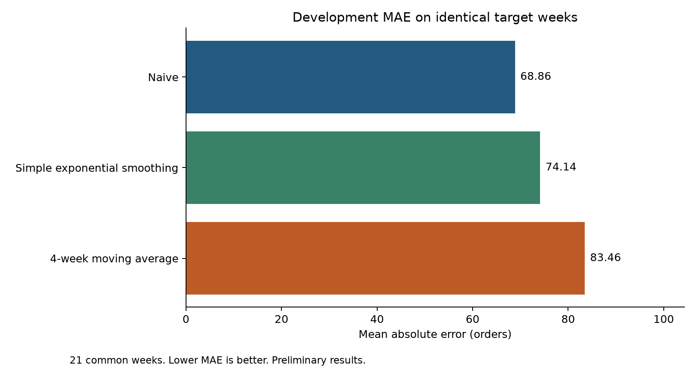

# Forecasting weekly retail orders

How accurately can last week's sales predict next week's order volume? This term paper uses the Online Retail II dataset to compare three one-week-ahead forecasts: the previous week's count, a four-week moving average and simple exponential smoothing. It includes the original workbook, the prepared weekly series and the preliminary midterm results.

On the **21 development weeks** that all three methods could forecast and score, the naive forecast had the lowest mean absolute error (MAE): **68.86 orders**, followed by simple exponential smoothing (74.14) and the moving average (83.46). The final 26 weeks are reserved for a later evaluation. They appear in the source data and exploratory charts but contribute neither to parameter selection nor to these scores.



## Run the project

Open a terminal in the project directory. The project was tested with Python 3.14. To install the dependencies in a virtual environment on Windows, run:

```powershell
python -m venv .venv
.\.venv\Scripts\python.exe -m pip install -r requirements.txt
```

In VS Code, use **Python: Select Interpreter** to select the project environment, then open a new terminal. From that terminal, run:

```sh
python main.py
```

The full run reads more than a million rows across two Excel worksheets, prepares the weekly data, generates the charts and runs the experiment. It can take several minutes. To reproduce just the forecasting comparison using the included weekly table, run:

```sh
python main.py --from-weekly results/weekly_orders.csv
```

The faster command validates the weekly calendar and order counts. Run the full pipeline whenever the workbook or the cleaning rules change. Use `--output PATH` to write the results of a new run to a separate directory.

## Counting weekly orders

An order is a distinct numeric invoice ID with at least one line showing both a positive quantity and a positive price. An invoice can cover several rows or appear in both worksheets. Count it once, on its earliest eligible date. This measures sales invoices. The workbook does not establish whether a delivery was completed. A customer ID is optional.

Each week runs from Monday through Sunday. The pipeline drops incomplete weeks at either end and retains every intervening calendar week. A week with source records but no eligible sales has a count of zero. A week with no source records has a missing count.

The main analysis preserves these missing values. To explore the alternative assumption that a week without records had zero sales, rebuild from the workbook:

```sh
python main.py --assume-empty-weeks-zero --output results-zero-assumption
```

This command also reruns the experiment under the new assumption. The flag cannot be combined with `--from-weekly`.

## Forecasting methods

| Method | Forecast for the target week | Missing observations |
| --- | --- | --- |
| Naive | The previous calendar week's observed count | No forecast if that week is missing |
| Four-week moving average (MA4) | The mean of the four immediately preceding calendar weeks | Requires all four counts |
| Simple exponential smoothing (SES) | The most recent level available before the target week | Retains the current level across missing observations |

SES starts at the first observed training count. Each new observation updates the level as `level = alpha * observation + (1 - alpha) * previous_level`. The experiment evaluates alpha values from 0.05 to 1.00 in steps of 0.05, selects the value with the smallest sum of squared one-step training errors and holds it fixed thereafter. The initial level is set before this grid search.

## Evaluation design

The default split uses the first 52 calendar weeks for training and the last 26 for the final holdout. The intervening weeks form the development period. For the supplied workbook, there are 52 training weeks, 26 development weeks and 26 final holdout weeks.

The evaluation advances one week at a time. Each observed development count becomes available for the following week's forecast. MAE is the mean absolute difference between actual and predicted counts. All three methods are scored on the same weeks using unrounded predictions. The forecast table retains excluded weeks and gives the reason for each exclusion.

Development scores can guide changes to the methods. Once they influence those choices, an independent final assessment requires the separate holdout. The code for this midterm experiment leaves that assessment open.

## Project files

| Path | What it contains |
| --- | --- |
| `main.py` | Workbook loading, invoice filtering, weekly aggregation, exploratory plots and the command-line entry point |
| `forecasting.py` | Forecasting methods, alpha selection, MAE and comparison charts |
| `test_preparation.py`, `test_forecasting.py` | Data preparation, forecast calculations and checks for look-ahead bias |
| `requirements.txt` | Pinned versions of pandas, openpyxl and Matplotlib |
| `data/online_retail_II.xlsx` | Original dataset |
| [Weekly orders](results/weekly_orders.csv) | Week dates, order counts and source-record indicators |
| [Preparation notes](results/data_preparation.md), [quality report](results/data_quality_report.json), [invoice date conflicts](results/invoice_date_conflicts.csv) | Cleaning rules, data checks and invoices with conflicting timestamps |
| [Weekly counts](results/weekly_orders.png), [smoothed counts](results/weekly_orders_smoothed.png) | Exploratory charts. The plotted trailing mean includes the current week, while the MA4 forecast uses the four preceding weeks. |
| [Experiment notes](results/midterm/experiment_notes.md), [protocol](results/midterm/experiment_protocol.json), [evaluation](results/midterm/results_evaluation.md) | Methods, evaluation dates, results and limitations |
| [Forecast table](results/midterm/development_forecasts.csv), [forecast chart](results/midterm/development_forecasts.png) | Development forecasts, actual values and excluded weeks |
| [Method comparison](results/midterm/method_comparison.csv), [MAE chart](results/midterm/mae_comparison.png) | Errors measured on the common evaluation weeks |
| [Evaluation split](results/midterm/evaluation_split.png), [alpha search](results/midterm/alpha_search.csv) | Chronological split and training errors for each SES parameter value |

## Run the tests

```sh
python -m unittest -v test_preparation test_forecasting
```

The tests cover distinct invoice counts, cancellations, week boundaries, missing values, forecast formulas, a hand-calculated MAE example, the common evaluation weeks and the independence of earlier forecasts from future observations.

## Data and methods references

The bundled workbook is the original **Online Retail II** dataset by Daqing Chen (2012), distributed by the UCI Machine Learning Repository under CC BY 4.0. The weekly series and forecast results were derived from it using the rules above. [Dataset and citation](https://doi.org/10.24432/C5CG6D) · [Dataset license](https://creativecommons.org/licenses/by/4.0/)

The forecasting protocol draws on Hyndman and Athanasopoulos, *Forecasting: Principles and Practice*. See [time series cross-validation](https://otexts.com/fpp3/toolbox.html#time-series-cross-validation), [simple exponential smoothing](https://otexts.com/fpp3/exponential-smoothing.html#simple-exponential-smoothing) and the project's [annotated references](references.md).

The repository contains the technical results for the midterm. The literature review, the author's interpretation, the progress report and the presentation are separate coursework deliverables.
